# Tracking electric fish in audian: quickstart

audian shows your recording. Its wavetracker plugin finds the fish in it and
lets you correct what it got wrong. This page takes you through the whole job
once, on a small demo recording, in about 15 minutes.

The panel has a lot of controls and you need very few of them. The job has five
steps:

1. [Install and open the demo](#1-install-and-open-the-demo)
2. [Get a spectrogram you can read](#2-get-a-spectrogram-you-can-read)
3. [Track](#3-track)
4. [Correct the tracks](#4-correct-the-tracks)
5. [Save](#5-save)

You cannot break anything. Every edit can be undone, audian never writes to the
recording, and saving keeps the tracker's original output.

## 1. Install and open the demo

You need [uv](https://docs.astral.sh/uv/) and Python 3.11 to 3.14.

```sh
git clone https://github.com/weygoldt/audian.git
cd audian
uv sync
uv run python scripts/wavetracker_demo.py ~/wavetracker-demo
uv run audian ~/wavetracker-demo/demo.wav
```

`uv sync` installs audian and wavetracker into one environment inside this folder,
so run `uv run` commands from here. Expect about 7 GB, most of it PyTorch. A GPU
makes tracking faster but is not required.

The demo is two minutes of six synthetic fish, built so that the tracker makes
its typical mistakes. It is seeded, so you should see the same track numbers as
on this page.

## 2. Get a spectrogram you can read

audian opens on the waveforms of every electrode. For tracking you want one
spectrogram, zoomed in on the fish. Do these in order:

| Do this | To get |
| --- | --- |
| <kbd>F3</kbd>, then <kbd>F2</kbd> | spectrograms on, waveforms off |
| <kbd>T</kbd> four times | all two minutes in view |
| click **S** next to channel 01 | one lane instead of four |
| across the whole width, drag a box around the bright lines at the bottom, from about 1 kHz (the lowest small tick) down to 0.4 kHz | only the band with the fish |
| <kbd>Shift</kbd>+<kbd>R</kbd> five times | sharp lines instead of blurry blocks |

The box does not have to be exact. If it goes wrong,
<kbd>Ctrl</kbd>+<kbd>Shift</kbd>+<kbd>V</kbd> shows all frequencies again and
<kbd>T</kbd> zooms out in time.

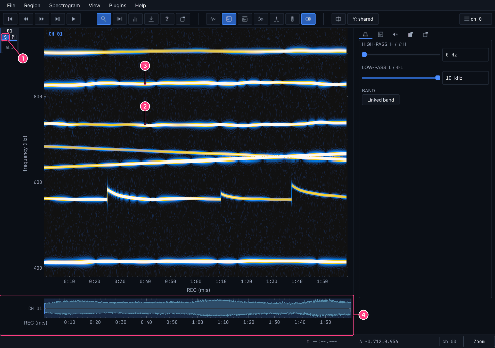

1. **S** shows only this electrode. Click it again for all of them. This only
   changes what you see: tracking always uses all electrodes.
2. A fish: a horizontal line at its frequency.
3. Not every line is a fish. This one, at 830 Hz, is the second harmonic of the
   fish at 415 Hz.
4. The navigator: the whole recording, with the part in view marked.

## 3. Track

Open **Plugins → Wavetracker**. This adds the **Tracks** tab on the right.

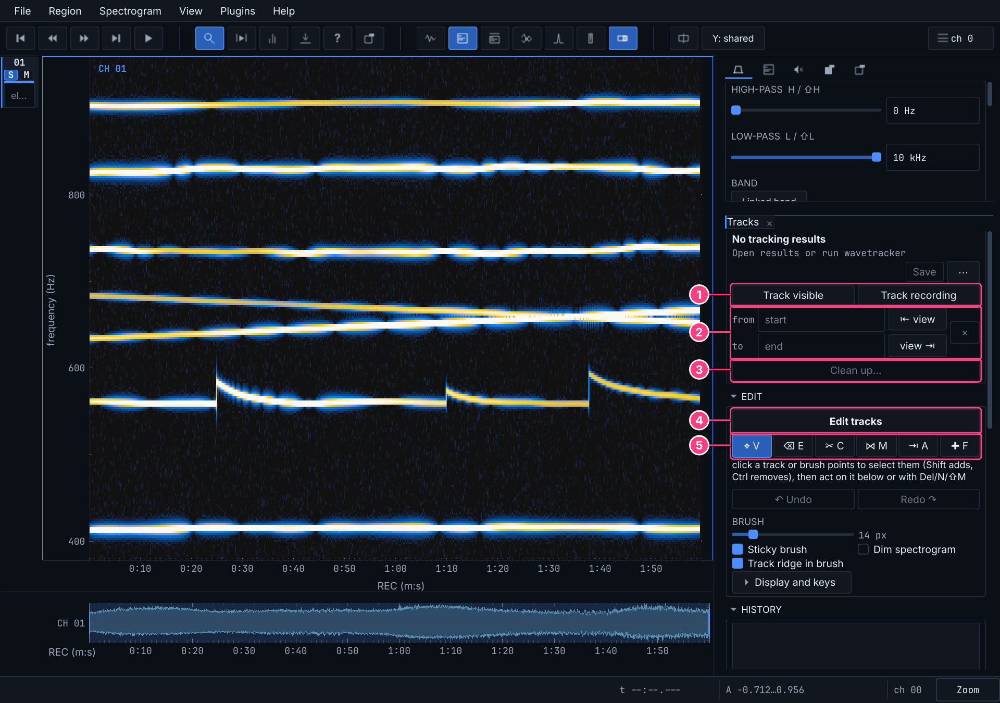

1. The tracker: **Track recording** runs over the whole file, **Track visible**
   over what is on screen.
2. *from* and *to* limit a run to a stretch. Leave them empty for now.
3. **Clean up…** is optional. Skip it for now.
4. **Edit tracks** gives the mouse to the correction tools.
5. The tools themselves. You will use three of the six.

Drag the tab's **scrollbar** down to **Run settings**. Use the scrollbar: over a
field, the mouse wheel changes the field's value.

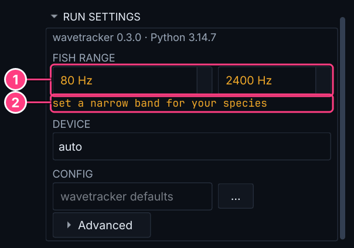

1. Enter the lowest and highest frequency your fish can have. For the demo,
   **350** and **1000** Hz. audian remembers it.
2. This note stays until you change the range from its wide default.

Scroll back up and press **Track recording**. It runs in the background with a
progress bar and **Cancel**, writes its results to a folder beside the recording
(`demo-wavetracker`), and opens them. On the demo it takes seconds. The first run
after installing takes a little longer.

## 4. Correct the tracks

Click **Edit tracks**. The left mouse button now belongs to the tools. Move the
pointer over the spectrogram: the track under it lights up, and a box beside the
pointer says what the next click will do. **Nothing changes until you click or
release, so read the box.** For a few seconds after an edit, it shows that edit
instead.

The panel calls tracks *ids*. Here is what the tracker got wrong on the demo:

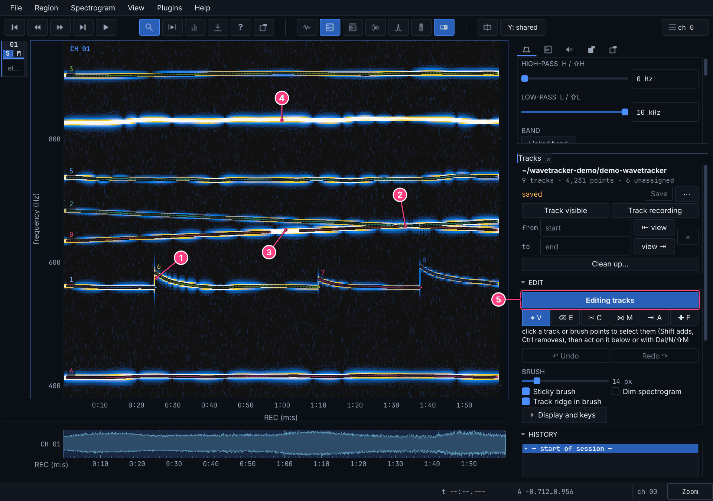

1. **Broken fish.** Each rise, a sudden jump in frequency, broke one fish into
   tracks 1, 6, 7 and 8.
2. **Swapped fish.** The fish on tracks 0 and 2 cross at about 1:34, but the
   tracks stay in their own bands, so from there on each follows the other fish.
3. **A hole.** Track 0 lost its fish from about 0:57 to 1:05.
4. Correct, leave it alone: the harmonic has no track, because it is not a fish.
5. The button shows that edit mode is on.

To move around in edit mode:

| Do this | To get |
| --- | --- |
| drag with the **middle** mouse button | move the spectrogram |
| <kbd>Ctrl</kbd>+wheel | zoom in time |
| <kbd>Shift</kbd>+wheel | zoom in frequency |

### Join a broken fish: Merge

1. Press <kbd>M</kbd>.
2. Click track **1**. It stays and takes the others in.
3. Point at track **6**. The box says what will happen. Click.
4. Click **7** and **8**, then press <kbd>Esc</kbd>.

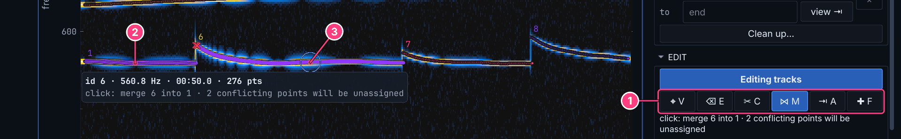

1. The Merge tool is on.
2. Track 1, which keeps its number.
3. The piece under the pointer, about to join it.

The ✕ marks *conflicting points*: frames where both tracks have a point. The one
closer to the track's course stays and the other is unassigned. That is normal
where two pieces meet.

### Untangle a crossing: Swap

Zoom in on the crossing first, to about 1:10–2:00 and 625–695 Hz.

1. Press <kbd>V</kbd>.
2. Click track **0**, then <kbd>Ctrl</kbd>+click track **2**. Both light up.
3. Put the pointer anywhere above **1:34**. Only its time counts.
4. Press <kbd>Shift</kbd>+<kbd>X</kbd>.

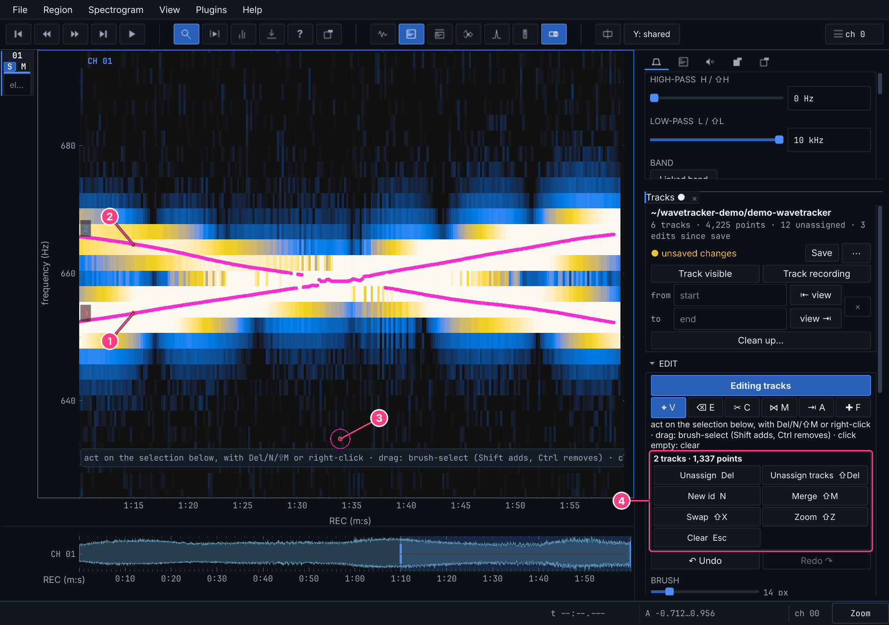

1. Track 0, selected.
2. Track 2, selected.
3. The pointer, at the moment the fish cross.
4. Whenever something is selected, this strip lists what you can do with it.

Afterwards each track runs straight through the crossing:

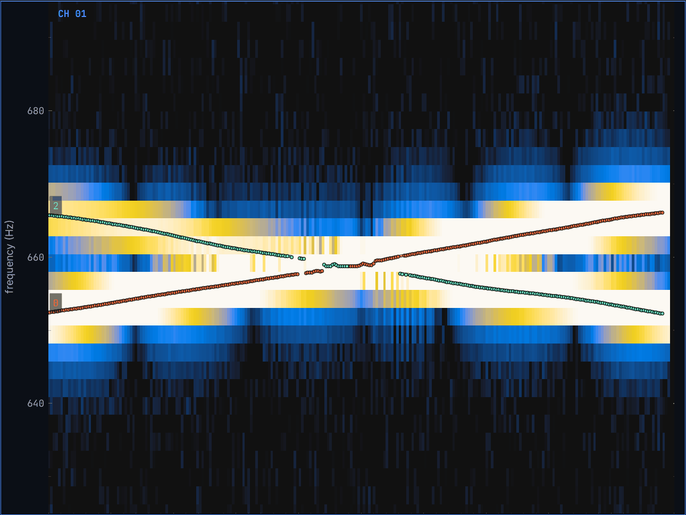

### Fill a hole: Add

Zoom to about 0:40–1:20 so that you can see both ends of the hole in track 0.

1. Press <kbd>Esc</kbd>, then <kbd>F</kbd>.
2. Press on the end of track **0**, drag along the hole to the other end, and
   release.

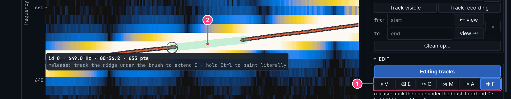

1. The Add tool is on.
2. The brush stroke. You do not have to be exact: the stroke only marks a region,
   and audian follows the strongest continuous line inside it. Where there is no
   clear line it adds nothing, rather than inventing points.

A stroke that starts or ends on a track extends it. Anywhere else it makes a new
track. <kbd>[</kbd> and <kbd>]</kbd> change the brush size. To paint exactly where
you drag instead, hold <kbd>Ctrl</kbd> while dragging.

### See what audian does with a harmonic

Zoom out until you can see the line at 830 Hz again, press <kbd>F</kbd>, and brush
along it.

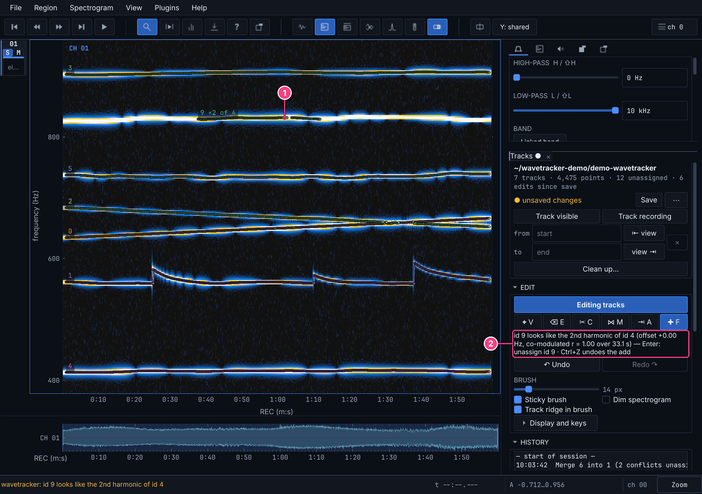

1. The new track is labelled **×2 of 4**: it runs at exactly twice track 4.
2. The message says so, for a few seconds. audian only warns; it is your call.

Press <kbd>Enter</kbd> to unassign it, which leaves you with six tracks.

### Other things you will run into

| The problem | The fix |
| --- | --- |
| a track that is not a fish | <kbd>V</kbd>, click it, <kbd>Shift</kbd>+<kbd>Del</kbd> |
| a few wrong points on a track | <kbd>E</kbd>, brush over them |
| one track that is really two | <kbd>C</kbd>, click where it should split |
| points on the wrong track | <kbd>V</kbd>, brush over them, <kbd>A</kbd>, click the right track |
| points that should be their own track | <kbd>V</kbd>, brush over them, <kbd>N</kbd> |

Points you remove from a track are not deleted. They become *unassigned*, stay
visible as dim dots, and can be assigned again.

**Made a mistake?** <kbd>Ctrl</kbd>+<kbd>Z</kbd> undoes,
<kbd>Ctrl</kbd>+<kbd>Shift</kbd>+<kbd>Z</kbd> redoes, and clicking a line in
**History** jumps back to that point.

**Not sure where to look?** <kbd>G</kbd> and <kbd>Shift</kbd>+<kbd>G</kbd> jump to
the next and previous suspicious place: gaps, very short tracks, likely joins,
harmonics. <kbd>Enter</kbd> applies the suggestion when there is one. On a gap it
picks the Add tool for you. It will not find everything: the rises on the demo
are too big for it to suggest a join.

## 5. Save

The demo is done when the top of the tab says **6 tracks**, one per fish. Press
**Save**.

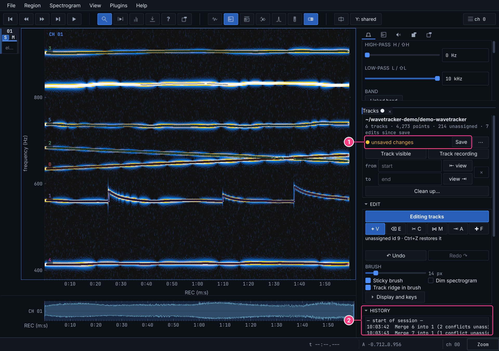

1. **Save** (or <kbd>Ctrl</kbd>+<kbd>S</kbd>). This line and a dot on the tab show
   that you have unsaved changes. Edits are also autosaved, so a crash does not
   lose them, and audian asks before closing without saving.
2. **History**: every edit since you opened the results.

Saving writes into the results folder. `ident_v.npy` now holds your corrected
tracks, and `ident_v.tracked.npy` keeps the tracker's original, which is never
overwritten. **⋯ → Revert to tracker output…** goes back to it.

To come back later, open the recording and **Plugins → Wavetracker**: it reopens
your results. <kbd>F3</kbd> and <kbd>F2</kbd> bring back the spectrograms.

To use the tracks in Python, with `uv run python` from the audian folder:

```python
from wavetracker.results import Results

results = Results.load("path/to/demo-wavetracker")
fish = results.ident_v == 1  # the detections of track 1
times = results.times[results.idx_v[fish]]  # s
freqs = results.fund_v[fish]  # Hz
```

## Your own recordings

```sh
uv run audian recording.wav
uv run audian session/*.wav    # a session split over files, joined by their timestamps
```

**Set the fish range** to the band your species lives in. A narrow band finds less
junk. **Run settings** folds itself after the first run: click its title to open
it. Press <kbd>Shift</kbd>+<kbd>R</kbd> until the fish are thin lines; how many
times depends on the sampling rate.

**Try your settings on a minute or two first.** **Track visible** tracks what is on
screen, up to five minutes, in seconds. The result is a *snippet*: a preview, drawn
as lines without dots, that you cannot click yet.

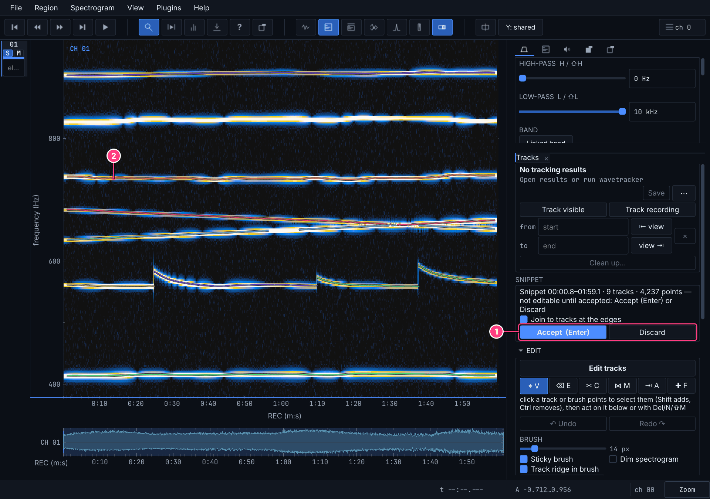

1. **Accept** keeps it, replacing any tracks in that stretch. **Discard** drops it.
2. A snippet's track.

Happy with it? Discard it and run **Track recording**. A 4 h recording on 11
electrodes took about a minute on a GPU.

**To skip a stretch**, say while the electrodes were out of the water, use *from*
and *to*, or go there and press **⇤ view** and **view ⇥**. **×** clears it.

**Clean up…** joins the tracks of the most persistent fish and unassigns the rest.
It can save a lot of work on long recordings of a few resident fish. It changes
nothing without asking: press **OK**, and when it finishes it tells you what it
would do, for you to **Apply** or **Cancel**. Read that message. On the demo it
says *kept 6 ids, 452 points reassigned, 322 unassigned*, and those 322 points are
real pieces of the rising fish, so there the answer is **Cancel**. On dense
recordings it may find nothing to keep. Correcting by hand does not depend on it.

**The tracker does not look at the picture on your screen.** wavetracker reads the
raw audio of all electrodes and computes its own, much finer spectrogram (*Run
settings → Advanced*; 1.6 s windows on the demo, against the 0.4 s on screen). The
display's zoom, filters, denoisers and colours do not change what it finds. So
tracks can separate two fish that look like one line on screen.

**Already have wavetracker results?** **⋯ → Open results…**

## When something seems wrong

| What you see | Why, and what to do |
| --- | --- |
| clicking a track does nothing | **Edit tracks** is off, or a snippet is still pending: press **Accept** |
| keys do something else, or nothing | the plugin's keys work only in edit mode, with the pointer over a lane and the cursor not in a text box (click the spectrogram first). Elsewhere they are audian's own: <kbd>G</kbd> is the grid, <kbd>Ctrl</kbd>+<kbd>Z</kbd> is pan mode |
| no tracks on screen | the spectrograms are off (<kbd>F3</kbd>), or the view is outside the band of the tracks |
| an empty spectrogram after <kbd>Backspace</kbd> | a known glitch in zoom-back: <kbd>Shift</kbd>+<kbd>Backspace</kbd> returns |
| the tracker misses fish | check the fish range first. Then *Run settings → Advanced* |
| "use Track recording for spans this long" | Track visible stops at five minutes |
| "zoom out: wavetracker needs at least two FFT windows" | the view is too short to track |
| Clean up finds nothing to keep | it is made for a few persistent fish. Correct by hand |
| dragging is slow | a shorter time window and fewer lanes help most (**S**) |
| audian will not start and mentions PortAudio | on Debian and Ubuntu: `sudo apt install libportaudio2` |

## Keys

These work in edit mode, with the pointer over a lane. The full list is under
**Display and keys** in the Edit section.

| Key | Does |
| --- | --- |
| <kbd>V</kbd> <kbd>E</kbd> <kbd>C</kbd> <kbd>M</kbd> <kbd>A</kbd> <kbd>F</kbd> | Select, Erase, Cut, Merge, Assign, Add |
| <kbd>Esc</kbd> | cancel, one level at a time |
| <kbd>Ctrl</kbd>+<kbd>Z</kbd> / <kbd>Ctrl</kbd>+<kbd>Shift</kbd>+<kbd>Z</kbd> | undo / redo |
| <kbd>Ctrl</kbd>+<kbd>S</kbd> | save |
| <kbd>G</kbd> / <kbd>Shift</kbd>+<kbd>G</kbd> | next / previous suspicious place |
| <kbd>Enter</kbd> | accept the pending snippet or the suggestion |
| <kbd>Del</kbd> / <kbd>Shift</kbd>+<kbd>Del</kbd> | unassign selected points / whole selected tracks |
| <kbd>N</kbd> | selected points become a new track |
| <kbd>Shift</kbd>+<kbd>M</kbd> | merge the selected tracks |
| <kbd>Shift</kbd>+<kbd>X</kbd> | swap two selected tracks after the pointer |
| <kbd>Shift</kbd>+<kbd>Z</kbd> | zoom to the selection |
| <kbd>[</kbd> / <kbd>]</kbd> | smaller / larger brush |
| <kbd>U</kbd> | show / hide unassigned points |
| right-click | the same actions as a menu |

---

The screenshots come from `scripts/wavetracker_shots.py`, which walks this page on
the real application and stops if the result no longer matches it.
